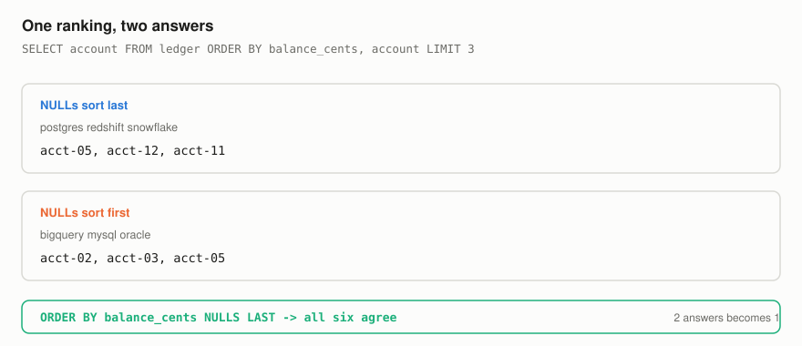
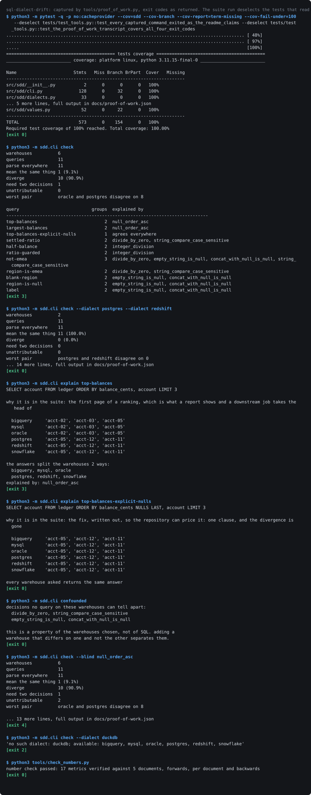
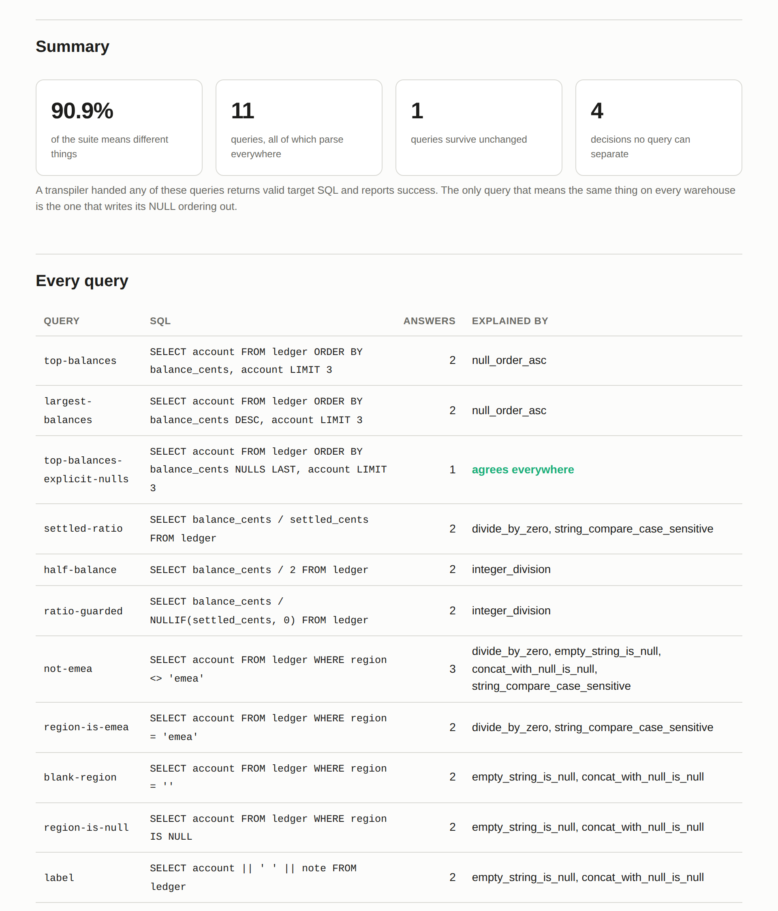

# sql-dialect-drift

A transpiler takes a query written for one warehouse and returns a query the
target warehouse accepts. Acceptance is what it can check. Acceptance is not
what anybody wanted.

The question asked of a migration is whether the numbers come out the same, and
no amount of syntactic validity answers it. This repository takes 11 queries a person
would write without thinking twice, runs them against a model of six
warehouses, and counts.

All 11 of them parse on all 6 warehouses. **10 of them mean
different things**, which is 90.9% of the suite, exactly 1 query survives
unchanged, and the attribution leaves 0 unattributable.

## What the one survivor has that the others do not

It writes the thing out.

```sql
-- diverges: NULLs sort last on Postgres, Snowflake and Redshift,
-- and first on BigQuery, Oracle and MySQL
SELECT account FROM ledger ORDER BY balance_cents, account LIMIT 3

-- agrees everywhere
SELECT account FROM ledger ORDER BY balance_cents NULLS LAST, account LIMIT 3
```

One clause. The first query gives 2 answers across the six warehouses; the
second goes to 1 answer, down from 2 answers, and that is the entire cost of the fix. The repository ships both so
the price is on the record rather than asserted.

## Why ordering is not a cosmetic difference

Two warehouses returning the same rows in a different order feels like nothing,
and it is, right up until a query says `LIMIT`, or a report shows the first
page, or a downstream job takes the head of the file. Then the order is the
answer.

The shipped ledger has two accounts with a NULL balance. Ranking by balance and
taking the top three returns three real accounts on Postgres and two accounts
that have never settled anything on BigQuery, with no error anywhere and no
difference in the SQL text.



## The full suite

<!-- table:queries generated by tools/render_tables.py from the suite -->
| query | parses everywhere | answers | explained by |
| --- | --- | --- | --- |
| `top-balances` | yes | 2 | null_order_asc |
| `largest-balances` | yes | 2 | null_order_asc |
| `top-balances-explicit-nulls` | yes | 1 | agrees everywhere |
| `settled-ratio` | yes | 2 | divide_by_zero, string_compare_case_sensitive |
| `half-balance` | yes | 2 | integer_division |
| `ratio-guarded` | yes | 2 | integer_division |
| `not-emea` | yes | 3 | divide_by_zero, empty_string_is_null, concat_with_null_is_null, string_compare_case_sensitive |
| `region-is-emea` | yes | 2 | divide_by_zero, string_compare_case_sensitive |
| `blank-region` | yes | 2 | empty_string_is_null, concat_with_null_is_null |
| `region-is-null` | yes | 2 | empty_string_is_null, concat_with_null_is_null |
| `label` | yes | 2 | empty_string_is_null, concat_with_null_is_null |
<!-- /table:queries -->

The queries are ordinary. A ratio in a computed column. An exclusion filter. A
concatenated label. A check for blank values. The sort of thing that exists in
every warehouse in the world and that nobody re-reads during a migration,
because it obviously works.

## Nobody migrates to six warehouses

The number a migration plan wants is the one for its own pair.

<!-- table:pairs generated by tools/render_tables.py from exp01.json -->
| from | to | queries that disagree |
| --- | --- | --- |
| oracle | postgres | 8 |
| oracle | redshift | 8 |
| mysql | postgres | 7 |
| mysql | redshift | 7 |
| mysql | oracle | 6 |
| oracle | snowflake | 6 |
| mysql | snowflake | 5 |
| bigquery | oracle | 4 |
| bigquery | postgres | 4 |
| bigquery | redshift | 4 |
| bigquery | mysql | 3 |
| bigquery | snowflake | 2 |
| postgres | snowflake | 2 |
| redshift | snowflake | 2 |
| postgres | redshift | 0 |
<!-- /table:pairs -->

The worst pair disagree on 8 of the queries in the suite. 1 of the fifteen
pairs disagree on 0 of them, and it is Postgres to Redshift, which is the migration
nobody worries about. The pairs people plan for months are the ones in the
middle of that table.

## How a divergence gets attributed

Grouping warehouses by answer is easy. Saying which decision produced the
grouping is what turns a diff into something a plan can act on, and it is done
by matching partitions rather than by guessing.

A decision explains a split when partitioning the warehouses by that decision's
value produces the same partition the answers did. If exactly one decision
matches, the divergence is attributed to it. If several match, they are
confounded across these warehouses and the finding names all of them. If none
matches, the split has a cause the model does not carry, and that is reported as
a fact about the model rather than dressed up as a finding.

All three cases occur. 1 query needs two decisions acting together, because its
predicate touches case folding and the empty string at once and neither produces
the three-way split alone.

## The uncomfortable part

**4 of the six decisions cannot be told apart by any query on these six
warehouses.**

Division by zero and case-sensitive comparison both single out MySQL and nothing
else. The empty-string rule and the NULL-concatenation rule both single out
Oracle. No query can separate the members of either pair, because separating
them needs a warehouse that differs on one and not the other, and none of the
six is that warehouse.

That is a statement about the six chosen, not about SQL. It matters because of
what it does to the model's own blind spots:

<!-- table:blind generated by tools/render_tables.py from exp01.json -->
| decision removed from the model | queries it can no longer explain |
| --- | --- |
| `null_order_asc` | 2 |
| `integer_division` | 2 |
| `divide_by_zero` | 0 |
| `string_compare_case_sensitive` | 0 |
| `empty_string_is_null` | 0 |
| `concat_with_null_is_null` | 0 |
<!-- /table:blind -->

Remove a decision from the model and re-run. Removing `null_order_asc` leaves
two queries with no explanation, which is the tool correctly saying it no longer
understands them. Removing either half of a confounded pair leaves **nothing**
unexplained, because the partner covers for it.

So a decision this repository has never heard of would, if it happened to
partition these warehouses like one it does know, be silently absorbed. The
model would look complete. `sdd check --blind` exists so a reader can watch that
happen rather than take it on trust, and only 2 of them become unattributable
under the worst single blinding, which is how small the model's visible margin
of error is.

## Proof of work

The transcript below was produced by running the commands, not by transcribing
them. `tools/proof_of_work.py` executes each one in a subprocess, records the
exit code, and fails the build when a command does not exit the way this README
says it does, so all four documented exit codes are demonstrated rather than
asserted.

Elapsed times and absolute paths are normalised so the committed image does not
change on every run; nothing else is touched, and the full untruncated output
with a SHA-256 of each command's bytes is in `docs/proof-of-work.json`.



The generated HTML report, screenshotted by Chromium as part of `make report`:



## Running it

Everything is offline and deterministic. No warehouse connection, no
credentials, no network at runtime.

```bash
python3 -m venv .venv && . .venv/bin/activate
pip install -e ".[dev]"
make verify
```

```bash
sdd check                              # every query on every warehouse
sdd check --dialect postgres --dialect redshift   # one migration's answer
sdd explain top-balances               # one query, every answer, and the reason
sdd confounded                         # decisions these warehouses cannot separate
sdd check --blind null_order_asc       # what the tool looks like when it is wrong
sdd table                              # the fixture, twelve rows
```

| code | meaning |
| --- | --- |
| 0 | every query means the same thing on every warehouse asked |
| 2 | the tool was handed something it cannot work with |
| 3 | a divergence was found |
| 4 | a divergence was found that the model cannot attribute |

Three is the tool working. Four is the tool admitting its model is incomplete,
and they should reach different people: a three goes to whoever owns the
migration, a four goes to whoever owns this repository.

## What this is not

It is not a SQL parser, and ADR-001 says why: a parser would be a large amount
of code in service of a point that six operators make, and every line of it
would be somewhere for a reader to lose the argument.

It is not a claim to have catalogued SQL's divergences. Six decisions are
modelled and ADR-003 lists what is missing, starting with time zones, which is
the family that costs the most and is the hardest to model honestly.

It is not a substitute for running the queries. It is an argument about what
running a transpiler does and does not tell you, made small enough that a
sceptic can check it with a pencil.

## Bugs the measurement found

**Five warehouses behaving identically were recorded as five different answers.**
The division-by-zero error carried the dialect's name in its message, so five
warehouses that raise for the same reason rendered five distinct strings. The
split defeated the attribution and reported the query as unexplained. An error
is an answer, so warehouses that fail for the same reason have to render the
same string.

**Two error messages raised from inside their own error path.** `cannot sort`
and `cannot compare` both built their text with a helper that itself raises on a
value it cannot name, so a clear diagnostic became an obscure one at the worst
possible moment. Branch coverage found both on the same afternoon.

**Sorting carried machinery for a case that could not arrive.** The sort key
returned a pair whose first element flagged NULLs, and branch coverage showed
the flag was never set, because the sort partitions NULLs out before it compares
anything. The pair is gone.

## How the numbers stay true

Every figure in this document is produced by code that ran.
`tools/collect_metrics.py` re-measures every one of them into `docs/metrics.json`, and
`tools/check_numbers.py` fails the build when a document quotes one the code no
longer produces, across three passes: every metric must appear with its current
value, every document is searched separately for stale wording, and every number
in this README must correspond to a metric so a figure nothing re-measures
cannot quietly appear.

147 tests, 100.0% line and 100.0% branch coverage, and the suite runs offline
from a fresh clone.

## Reading order

1. `src/sdd/values.py` for why NULL is not None
2. `src/sdd/differential.py` for the attribution and its three refusals
3. `docs/adr/` for the three decisions and their costs
